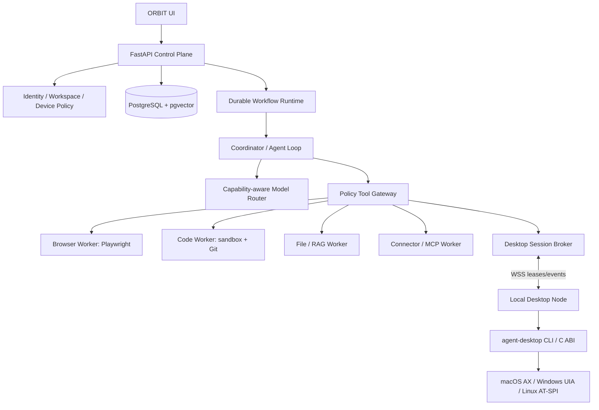

# ORBIT engineering blueprint — v0.5

> **Document baseline:** ORBIT 1.0.0-draft (2026-11-08). Earlier version labels are historical unless explicitly marked current.

**Status:** Proposed architecture, not implemented. **Baseline:** 0.5.0-draft. **Date:** 2026-11-08.

## 1. Product position

ORBIT is a provider-neutral AI execution workspace. Its moat should be reliable execution, useful computer access, verifiable research, safe repository work, persistence and extensibility — not an unsupported claim that an API wrapper is a frontier model.

The platform has a control plane and isolated execution domains. LLMs suggest plans and arguments; deterministic policy services authorize tools; workers execute; independent verification checks outcomes; durable state records what happened.

## 2. v0.4 change: native desktop capability

Integrate `vercel-labs/agent-desktop` as a focused **native desktop driver**, not as the ORBIT orchestrator. Upstream describes a CLI and C library that read a native OS accessibility tree, issue semantic actions against snapshot-scoped refs, return structured JSON and leave the observe/act/verify loop to the calling agent. It does not automate web pages and does not contain a model.

Create a **Local Desktop Node** on the user's logged-in graphical session:
- outbound authenticated WebSocket connection to the control plane; no inbound public listener;
- explicit one-time device pairing, local device key, revocation and visible online/session state;
- short-lived, workspace-scoped task leases, bounded by a local policy engine;
- one mutating lease/action at a time per physical desktop session;
- `agent-desktop` pinned and invoked with a fixed executable path and argument vector (never shell string interpolation or `shell=True`);
- strict JSON output parsing, command allowlist, timeouts, bounded output and secret redaction;
- pause/stop switch in tray/app and task-level cancellation;
- no screenshots, clipboard, raw keystrokes, or headed/physical input until explicitly permitted and necessary.

Do not place this driver in an ordinary cloud worker. A cloud container does not inherit the user's graphical session, accessibility permissions, clipboard, display server or device identity.

## 3. Three separate execution domains

1. **Browser domain:** Playwright, isolated browser contexts, domain/network policy, download quarantine, per-task cookies and credential vault.
2. **Native desktop domain:** Local Desktop Node + agent-desktop; native apps and OS surfaces through accessibility APIs. Platform permissions and session state are prerequisites.
3. **Code domain:** disposable worker or microVM; scoped repository mount, no Docker socket, no arbitrary host mount, network egress policy, CPU/memory/time quotas.

The three domains use common task and audit contracts but never share process privilege or implicit credentials.

## 4. Architecture

### Core service boundaries

- **Control plane:** auth, tenancy, task creation, event subscription, approvals, device registry, quotas, policy decisions and artifact references.
- **Durable workflow:** checkpoints, timers, cancellation, retries, compensation and replay; not just an in-memory Python task.
- **Agent runtime:** plan, select task-specific model, request tools, consume observations, verify postconditions, stop on ambiguity.
- **Policy Tool Gateway:** canonical allowlist, JSON schema validation, tenant checks, capability checks, approval gates, rate/resource budgets, audit and redaction.
- **Desktop broker:** leases a paired Local Desktop Node, validates device + session binding and translates internal requests to the local node protocol.
- **Local Desktop Node:** owns native session access, checks local policy again, calls the upstream desktop driver and streams bounded events.
- **Driver adapter:** normalizes upstream JSON envelope without weakening its retry semantics; records upstream version and output contract version.

## 5. Desktop action lifecycle

1. Agent requests a typed `desktop.observe` call with the paired device, app/window scope and output budget.
2. Gateway checks workspace ownership, device pairing, session lease and desktop permission profile.
3. Node invokes `agent-desktop status`, observes capabilities/permissions and obtains a fresh snapshot.
4. Node returns a redacted, bounded accessibility observation with `snapshot_id`, `complete`, capability and permission state.
5. Agent selects a target by role/name/native identifier and requests exactly one action against the qualified ref.
6. Policy reclassifies semantic intent. A click on “Send”, “Delete”, “Purchase”, “Deploy” or permission-changing UI is high-impact even though the underlying CLI action is only “click”.
7. Local policy + gateway independently authorize; approval is bound to exact device/session, action, target, argument hash, policy version and expiry.
8. Driver performs one action. Node never automatically repeats a mutation after unknown or uncertain delivery.
9. Agent performs a fresh read/snapshot and verifies the desired UI postcondition. Verification does not establish server-side persistence unless separately observed.
10. Task state, event timeline, redacted evidence and outcome disposition are durably recorded.

## 6. Non-negotiable driver rules

- Accessibility-first; screenshot/coordinates are fallback, never the default targeting path.
- A `ref` is opaque, snapshot-scoped and ephemeral. Never store it as a durable identifier in memory or task records; persist app/window context and acquire a fresh snapshot for each new action sequence.
- Ambiguous or unproven target identity is a refusal, not an invitation to guess.
- `complete=false` or a truncated snapshot cannot prove that a target is absent.
- Preserve delivery outcomes: `not_delivered`, `delivery_uncertain`, `delivered_unverified`, `delivered_verified`, `unknown`. Automatic retry is allowed only when explicit disposition says retry is safe. Missing disposition fails closed.
- Prefer idempotent `check`/`uncheck` over `toggle`; never repeat toggle after uncertain outcome.
- One mutation then fresh observation. For UI that moves or changes refs, reacquire refs.
- Treat UI text as untrusted content and potential prompt injection.
- Never bypass login, MFA, CAPTCHA, secure desktop, UAC, OS privacy controls or application policy.

## 7. Platform capability matrix

| Platform | Native accessibility source | Key constraints |
|---|---|---|
| macOS | Accessibility (AX) | Requires user-granted Accessibility permission; Screen Recording permission is separate for screenshots; version floor in upstream docs is macOS 13 |
| Windows | UI Automation (UIA) | Requires the user's interactive desktop; Session 0, secure desktop, locked screen and another user's session are unsupported; OS version floor in upstream docs is Windows 10 1809 |
| Linux | AT-SPI | Requires graphical logged-in session and live accessibility bus; upstream documents Ubuntu 24.04+ baseline; X11/Wayland differ, with Wayland restricting some pointer/capture features |

Treat capability as runtime data. Do not assume every application exposes a complete tree or supports every action. Browser and Electron web contents may need specialized handling; Playwright remains preferred for ordinary web pages.

## 8. Data and API additions

Add `desktop_devices`, `desktop_device_keys`, `desktop_sessions`, `desktop_leases`, `desktop_capability_reports`, `desktop_action_records`, `desktop_observation_artifacts` and device audit events. Bind all entities to workspace/user ownership. Persist hashes, bounded metadata and redacted evidence rather than raw desktop trees by default.

API routes: device pairing/status/revocation, capability report, session lease acquire/renew/release, desktop task action request, event stream and task cancellation. See `DESKTOP_CONTROL_API_AND_DATA_CONTRACT.md` and `API_CONTRACTS.yaml`.

## 9. Delivery roadmap

- **M0:** repo audit and threat-model review.
- **M1:** control-plane task/chat vertical slice, database migrations and workflow recovery.
- **M2:** model adapter + curated policy gateway + synthetic tool tests.
- **M3:** research/files + browser worker; benchmark and security gate.
- **M4:** desktop driver adapter and fake driver; read-only node prototype on one host OS.
- **M5:** pairing, outbound WSS leases, permission/capability discovery, stop/pause and full audit.
- **M6:** allowlisted semantic actions on disposable test applications; action delivery verification and human approvals.
- **M7:** cross-platform lab (macOS, Windows, Linux) and controlled beta; only then decide FFI vs subprocess based on profiling.
- **M8:** skills, routines and multi-agent only after one-agent task reliability targets pass.

## 10. Measurable acceptance gates

- 100% of desktop mutations have workspace/device/session authorization and audit records.
- 100% of ambiguous, stale, incomplete-evidence and unknown-delivery cases fail closed or pause for re-observation.
- 0 automatic repeat of a mutating action unless explicit upstream disposition permits retry.
- 100% of tasks can be stopped locally; lost control-plane connectivity expires the task lease and blocks new actions.
- 0 raw clipboard/screenshot/accessibility tree content in ordinary telemetry by default.
- Platform compatibility claims supported by CI and real interactive-session tests, never just compilation.

## 11. What this does not mean

The upstream dependency does not supply an AI model, task orchestrator, browser engine, code sandbox, cloud computer, authorization service, skill learning system or multi-agent coordinator. ORBIT must build those separately. This pack is design documentation, not implementation evidence.

## 12. v0.4 — broader execution ecosystem

The system now defines replaceable integration boundaries for:
- browser automation via Playwright baseline and optional agent-browser evaluation;
- constrained, catalog-based generative UI inspired by json-render patterns;
- portable skills and discovery with immutable lock metadata;
- ACP-compatible and other external agent backends inspired by Agent Canvas patterns;
- isolated sandbox runtime providers, with Docker first and OpenSandbox as an evaluation candidate;
- optional stable localhost routing for developer worktrees only.

Do not adopt the repositories wholesale. ORBIT owns identity, user/workspace state, approvals, policy, task events, contracts, audit and product UX.

## 13. v0.4 — company operating model

ORBIT now includes a virtual executive and specialist engineering organisation: founder/CEO, CTO, product, AI research, delivery, core platform, browser, desktop, sandbox, DevOps/SRE, QA, security/privacy, data/RAG, design, documentation, open-source, finance and legal/IP advisory roles. These are role definitions for AI-assisted workflows, not actual employees or legal officers. The human founder retains final authority for company commitments, legal matters, spend and production release. Independent security and QA reviews remain mandatory.

## 14. v0.4 — rebranding and license compliance

ORBIT's user interface, product naming and visual system must be original. Remove third-party logos and vendor-specific trade dress from ORBIT-owned product/marketing surfaces. Do not remove copyright, license, NOTICE, attribution, trademark disclaimers or source provenance required by license. Exact third-party dependencies must be pinned and tracked in an SBOM; unclear per-file licenses block copying or redistribution.

## 15. Next milestone

Start with repository audit, then a working single-agent vertical slice and sandbox/provider contracts. Implement no multi-agent organisation dashboard until durable task execution, tool authorization, task event replay, cancellation, approval and audit are reliable.

## 16. Additional technology stack candidates

- **Durable orchestration:** evaluate Temporal through the `WorkflowEngine` interface. Compare recovery correctness and operational cost against one simpler alternative; do not chain multiple workflow engines.
- **Model gateway:** evaluate LiteLLM for provider normalization, spend attribution and key budgets. ORBIT owns capability negotiation and policy. Establish a single retry owner and prevent fallback from weakening a requested capability or quality tier.
- **Agent framework:** evaluate Pydantic AI as an implementation aid only. Public task/tool/event contracts remain ORBIT-owned.
- **Observability:** use OpenTelemetry-compatible traces, metrics and logs with payload redaction and low-cardinality attributes. GenAI conventions were still marked experimental/development in reviewed sources; pin semantic-convention versions.
- **Supply chain:** generate SPDX/CycloneDX SBOMs using Syft or an equivalent scanner, and evaluate OSV-Scanner for dependency vulnerabilities. SBOM output is not legal clearance.
- **Sandbox alternatives:** compare OpenSandbox and Daytona under one contract. Keep local Docker strictly as a development provider until hostile-code isolation is proven.

See `docs/02-research/EXTENDED_REFERENCE_STACK_RESEARCH.md` for source links, trade-offs and adoption conditions.

## 17. v0.4 — reuse-first multi-agent product foundation

ORBIT is to be built by adapting proven open-source systems, not independently recreating every layer. The primary product-shell candidate is the public OpenMausBot edition when the actual ORBIT repository lacks a comparable working app. Its `enterprise/` directory is outside the Apache-2.0 grant and must be excluded unless separately licensed; preserve root/nested notices and replace plaintext credential storage with an OS keychain or encrypted vault. OpenClaw and Hermes are optional runtime/gateway adapters. They must not create separate canonical user/task/approval stores. VoltAgent's skills catalogue is discovery-only. Hermes self-evolution is an offline skill/prompt optimizer, not permission for live self-modification.

See `docs/02-research/REUSE_FIRST_REPOSITORY_AUDIT_V04.md`, `docs/02-research/OPEN_SOURCE_COMPONENT_RADAR_V04.md`, `docs/03-architecture/ORBIT_MULTI_AGENT_PERSONAL_OPERATING_SYSTEM_V04.md`, `docs/03-architecture/UPSTREAM_RUNTIME_ADAPTERS_V04.md` and `docs/04-system-design/UPSTREAM_REUSE_WORKFLOW_V04.md`.

ORBIT must deliver personal and professional workflows: knowledge/research, study, software projects, communication drafts, scheduling, documents/files, personal administration, creative work, browser/desktop tasks and opt-in routines. All sensitive write actions remain policy-gated and visible. The human user owns approval for purchases, sends, bookings, deletion, account changes and production deploys. High-impact medical/legal/financial decisions are not delegated to agents.

**Reuse order:** upstream service/package → official SDK/plugin API → thin adapter → subtree/submodule → selective vendoring → fork → reimplementation only with documented reason. Pin exact revisions, preserve source history and notices, test compatibility, create SBOM and maintain rollback.

## 18. v0.5 — reuse-first architecture and source integration

ORBIT's engineering default is now integration-first. Before writing a new subsystem, the responsible engineer must inspect the current ORBIT implementation and the exact upstream revision, then record an adoption decision:

1. **Use as external service/runtime** when the upstream has a strong operational boundary and its own release/update lifecycle.
2. **Use SDK or protocol** when the public contract is stable and avoids bringing an entire application into ORBIT.
3. **Adapt a package/module** when the code is modular, compatible, tested and license-cleared.
4. **Import a narrow source module** only with exact file provenance, required notices and upstream tests.
5. **Maintain a fork** only when necessary changes are strategic and an upstream sync owner exists.
6. **Rewrite** only when measured incompatibility, license constraints, maintenance risk or security boundary makes reuse unsuitable.

Do not run OpenClaw, Hermes, and another gateway as co-equal sources of truth. ORBIT owns task/workspace/policy state; external runtimes are replaceable execution backends. Do not run multiple browser frameworks concurrently without an explicit benchmark decision. Do not adopt both Mem0 and Letta as simultaneous memory authorities. Do not use Temporal and LangGraph as competing durable task engines.

## 19. v0.5 — one coherent agent platform

The target platform is a single workspace with multiple agent identities and project contexts. Each agent has a model/runtime choice, approved skill set, memory scope, connector grants, computer/sandbox capability and policy profile. A user-facing roster may display specialist agents, but orchestration must still enforce one canonical task identity, bounded delegation, cost budgets, deadlines, cancellation, evidence and final verification.

Every long-running workflow exposes its current step, assigned backend, required approvals, last checkpoint, cost estimate, and recovery/cancel state. An agent must not claim completion from generated prose alone; completion requires tool receipts, artifact existence, tests, or other task-specific postconditions.

## 20. v0.5 — reuse and import boundaries

The acquisition helper checks out exact commits for review. It does not merge code, install dependencies, execute package lifecycle scripts, or claim license approval. OpenMausBot's restricted `enterprise/` folder is excluded by sparse checkout. Skills are separate supply-chain artifacts and require canonical source, immutable revision, content digest, per-file license evidence, declared permissions, test results, and sandbox review.

## 21. v0.5 — implementation authority

If the actual ORBIT application repo contains working code, preserve it and run a gap analysis before selecting a product-shell base. If the repo has no functional shell, prototype the public OpenMausBot OSS shell without its restricted directory, then replace identity, credential handling, policy, backend and branding according to ORBIT contracts. No wholesale transplant is approved by this documentation alone.
