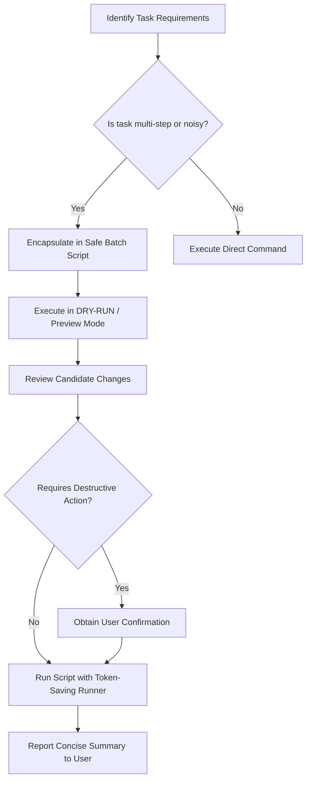

# Safe Windows Batch Automation

This skill guides the safe creation, wrapping, and execution of Windows Batch (`.bat` / `.cmd`) automation scripts. It maximizes efficiency by cutting token consumption and eliminates risks of accidental data loss through rigorous safety guardrails.

---

## Why Batch Automation Saves Tokens

In agentic programming, running iterative terminal commands (`run_command`) consumes thousands of tokens because:
1. **Multi-Turn Roundtrips**: Each individual command triggers a new full context re-read. Running 5 steps sequentially in 5 separate turns re-processes the entire prompt history 5 times.
2. **Output Bloat**: Build tools, test suites, linters, and package managers dump hundreds or thousands of lines into the conversation context.
3. **By contrast, Batch Automation**:
   - Bundles multi-step routines into a **single local execution**.
   - Pipes noisy command output into a disk log file (`> task.log 2>&1`).
   - Emits a concise 3–5 line status summary back to the agent.
   - On errors, extracts only the last 10 lines (the root cause) instead of the whole output.

> [!TIP]
> Using batch runners can reduce token consumption on repetitive tasks by **up to 95%** while retaining complete audit logs on disk.

---

## The 5 Golden Safety Rules

Every batch script written or executed under this skill **MUST** strictly enforce these rules:

1. **Mandatory Environment Isolation**:
   Always begin with `setlocal EnableExtensions EnableDelayedExpansion`. Never leak global environment changes or cross-contaminate sessions.
2. **Empty Variable & Root Drive Guard**:
   NEVER execute `del`, `rmdir`, or `move` on unverified paths.
   ```bat
   if not defined TARGET_DIR (echo [ERROR] Unset path & exit /b 1)
   if "%TARGET_DIR%"=="" (echo [ERROR] Empty path & exit /b 1)
   ```
   Always verify the resolved path is not a drive root (e.g. `C:\`) or `%SystemRoot%`.
3. **Fail-Fast Error Trapping**:
   Check `IF ERRORLEVEL 1` or `IF !ERRORLEVEL! NEQ 0` immediately after every critical command. Abort further steps if a prerequisite fails.
4. **Dry-Run / Preview First**:
   Any script performing file deletion, overwrites, or process termination must support `--dry-run` or require `--confirm` before mutating data.
5. **No Parentheses Trap**:
   In batch `if (...)` or `for (...)` blocks, do not use unescaped `)` inside `echo` statements. Use square brackets `[...]` instead (e.g., `echo [DRY-RUN] Preview mode`).

For comprehensive edge-case guidance, see the [Batch Safety Guide](./references/batch_safety_guide.md).

---

## Pre-Built Helper Scripts

This skill includes battle-tested helper scripts ready for immediate use:

### 1. `safe_runner.bat` — Silent Token-Saving Command Runner
Use this wrapper to execute any noisy command without flooding the context window with tokens:

```powershell
& "C:\Users\YUVRAJ\.gemini\config\skills\safe-batch-automation\scripts\safe_runner.bat" "<Task Label>" "<Command String>"
```

**Features**:
- Captures full stdout and stderr to a timestamped log file (`logs\run_*.log`).
- Times execution.
- Emits a clean, 2-line summary on success (`[SUCCESS] Task completed in 2s [Code: 0]`).
- On failure, outputs only the last 10 diagnostic lines from the log.

### 2. `safe_clean.bat` — Safe Project Cleanup
Use to clean caches (`__pycache__`, `.pytest_cache`, `dist`, `build`, `.tmp`, `.log`):

```powershell
# Safe Preview (Dry-Run mode by default - deletes nothing):
& "C:\Users\YUVRAJ\.gemini\config\skills\safe-batch-automation\scripts\safe_clean.bat" ".\my_project"

# Confirmed Execution (Only after reviewing preview):
& "C:\Users\YUVRAJ\.gemini\config\skills\safe-batch-automation\scripts\safe_clean.bat" ".\my_project" --confirm
```

### 3. `template.bat` — Production-Ready Batch Boilerplate
When creating a new custom automation script for a project, copy and adapt [template.bat](./scripts/template.bat):
- Built-in `--dry-run` and `--verbose` flag parsing.
- Step-by-step modular routines (`call :TASK_STEP`).
- Automated timestamped logging.

### 4. `rea_runner.bat` — Safe REA Workspace Automation in `D:\rea`
Controls and automates builds, checks, dependency validation, and CLI commands for the REA reverse engineering repository on drive `D:`:

```powershell
# Check dependencies in D:\rea:
& "C:\Users\YUVRAJ\.gemini\config\skills\safe-batch-automation\scripts\rea_runner.bat" deps

# Run build silently:
& "C:\Users\YUVRAJ\.gemini\config\skills\safe-batch-automation\scripts\rea_runner.bat" build

# Run REA doctor diagnostics:
& "C:\Users\YUVRAJ\.gemini\config\skills\safe-batch-automation\scripts\rea_runner.bat" doctor
```
Enforces cross-drive navigation (`cd /d D:\rea`) and architecture compatibility fallbacks for Windows ARM64.

---

## Recommended Step-by-Step Workflow

When asked to automate a task, run repetitive checks, or perform project maintenance:



1. **Assess & Bundle**:
   If a task involves multiple commands or generates verbose output, write a local `.bat` file (or use `safe_runner.bat`) instead of calling 5–10 individual terminal tools.
2. **Incorporate Safeguards**:
   Add `--dry-run` flags and variable validation guards.
3. **Preview First**:
   Execute the batch script with `--dry-run` to inspect what files or actions will occur.
4. **Execute & Contain**:
   Execute the confirmed script. All granular logs remain safely on disk in the `logs/` directory.
5. **Report Summary**:
   Provide the user with a concise summary table, duration, and link to the generated log file.

---

## Reference Material

- [Batch Safety Guide](./references/batch_safety_guide.md) — Common batch bugs, escaping traps, and data-loss prevention rules.
- [Token Optimization Patterns](./references/token_optimization_patterns.md) — Quantitative strategies for minimizing context tokens with batch workflows.

