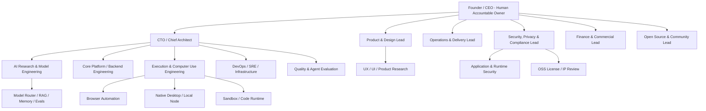

# ORBIT organisation chart

> **Document baseline:** ORBIT 1.0.0-draft (2026-11-08). Earlier version labels are historical unless explicitly marked current.

**Version:** 0.3.0-draft. **Purpose:** reporting lines for human accountability and AI-assisted role execution.

## Role instantiation rules

- The founder is the only assumed human executive and final accountable owner in this blueprint.
- The remaining roles are virtual role definitions. Do not claim that named people or independent agents have been hired or are active.
- CTO role may coordinate agents but must not self-approve production release, legal obligations or its own critical security review.
- Security is allowed to block unsafe deployment. QA must provide independent evidence for release gates.
- A single underlying model may fulfil multiple roles in early development. Role separation is logical accountability, not proof of multiple model instances.

## Scaling model

**Stage 0: Founder-led prototype** — founder plus a primary coding agent. Specialist role prompts are invoked sequentially; no autonomous delegation.

**Stage 1: MVP team** — add independent QA/security review, product design and SRE ownership. Use separate worktrees/branches for parallel implementation.

**Stage 2: Private beta** — add customer support, developer relations, data/privacy operations and a dedicated security review cadence.

**Stage 3: Commercial operation** — hire human leaders for statutory, commercial, security, customer and operational accountability. AI role agents remain assistants.
