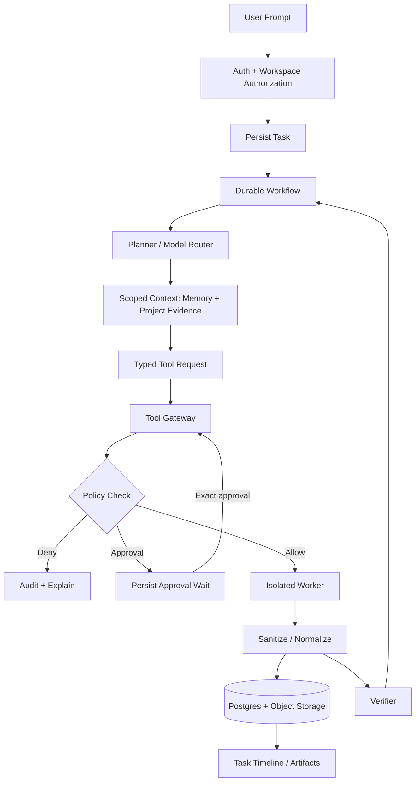

# Data Flow and Trust Boundaries

> **Document baseline:** ORBIT 1.0.0-draft (2026-11-08). Earlier version labels are historical unless explicitly marked current.

Trust labels: T0 control plane/code/policy; T1 user-authorized data (still possibly hostile); T2 external pages/email/repos/files/MCP descriptions (untrusted); T3 model-generated plans/tool arguments/code (untrusted). T2/T3 cannot alter T0 policy. External instructions are never equivalent to user consent.

## ORBIT v0.2 alignment

The v0.2 architecture adds a Local Desktop Node and Desktop Session Broker. Native OS access remains separate from Playwright and the code sandbox; see `DESKTOP_COMPUTER_USE_ARCHITECTURE.md` and ADR-013.
