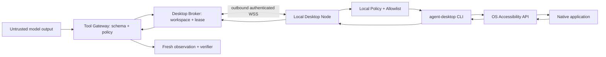

# Native desktop computer-use architecture

> **Document baseline:** ORBIT 1.0.0-draft (2026-11-08). Earlier version labels are historical unless explicitly marked current.

## Purpose

Provide ORBIT agents with controlled access to native desktop applications on a user's own computer. This is separate from web automation and remote cloud code execution.

## Components

### Desktop Session Broker (control plane)

- Authenticates a paired Local Desktop Node and verifies its device certificate/key.
- Binds each node to a user and workspace, with explicit device revocation.
- Issues short-lived leases for one task, one desktop session and one approved capability set.
- Enforces workspace and actor authorization before forwarding actions.
- Emits durable events and audit records; never trusts node-reported success without a structured result.

### Local Desktop Node

- Installed by the user and started in their signed-in graphical session.
- Holds a device identity in an OS secure store where available; does not persist provider API keys.
- Opens outbound authenticated WSS to the broker. It exposes no public inbound port.
- Shows device status, current task, active permissions and pause/stop controls.
- Enforces a local command allowlist, lease expiry, resource limits and one mutation at a time per physical desktop session.
- Starts the pinned `agent-desktop` executable using a subprocess argument array; parses bounded JSON output and redacts sensitive fields.
- On lost connectivity, lease expiry, user lock or unsupported session, refuses new mutations and terminates/cancels in-flight actions safely where possible.

### DesktopDriver adapter

Internal ORBIT interface. It maps ORBIT's normalized tool schema to upstream CLI commands. It does not reimplement AX/UIA/AT-SPI. It validates command version, JSON envelope and delivery disposition, and records the upstream driver version + contract version.

### Policy Tool Gateway

Performs tenant check, device/session match, capability and permission check, action risk classification, rate limits, exact approval binding and audit. It is the single authorization path for API, UI and agent-originated calls.

## Trust topology



## DesktopDriver contract (language-neutral)

```text
get_status(device_id) -> DeviceStatus
get_permissions(device_id) -> PermissionReport
list_apps(lease_id) -> AppList
list_windows(lease_id, app_scope?) -> WindowList
observe(lease_id, app_or_window_scope, observation_options) -> DesktopObservation
find(lease_id, snapshot_id, selector) -> MatchSet
get(lease_id, snapshot_id, ref, property) -> PropertyEvidence
is_state(lease_id, snapshot_id, ref, state) -> StateEvidence
perform(lease_id, action, ref, args, approval_context?) -> ActionReceipt
capture_screen(lease_id, scope, reason, approval_context?) -> RedactedImageArtifact
stop_session(lease_id, reason) -> StopReceipt
```

The action contract is intentionally narrow; methods must not accept arbitrary command strings. New methods require threat-model review, schemas, tests, docs and allowlist updates.

## DesktopObservation model

- `device_id`, `session_id`, `lease_id`
- `driver_name`, `driver_version`, `driver_contract_version`
- `platform`, `platform_version`, `architecture`
- app/process identity and window identity (opaque, with generation/lifecycle info where available)
- `snapshot_id` and `observed_at`
- `complete`, `truncated`, `nodes_observed`
- normalized accessibility tree with role, name/value/description evidence, native-id kind, states and available actions
- property evidence status: `known`, `absent` or `unknown`
- redaction metadata and output size accounting

Never return raw native pointers or assume that an OS window handle alone is a stable identity. Revalidate process/window generation at action time.

## Lease rules

- Lease is bound to `workspace_id`, `user_id`, `device_id`, `desktop_session_id`, `task_id`, allowed app scope, allowed capabilities, policy version and expiry.
- Default lease lifetime is short (initial engineering target 60 seconds, renewable only while task/user presence and policy permit). Final value configurable after usability testing.
- Only one mutating action can be in-flight per physical desktop session; read-only observations may be serialized initially for correctness.
- Reconnection requires reauthentication and lease revalidation. Expired lease is not silently resurrected.
- Revocation or local pause blocks new actions immediately. In-flight OS calls may not be cancellable, so final disposition must reflect uncertainty.

## Data flow and lifecycle

1. User explicitly pairs a local device and grants required OS access.
2. Broker stores key fingerprint, owner/workspace and status, not private desktop content.
3. User starts or authorizes a task to use the paired device.
4. Scheduler obtains a lease limited to the task's permitted capabilities.
5. Agent requests observation; gateway validates and broker forwards.
6. Local node checks OS session, permissions, local allowlist and lease.
7. Upstream driver returns JSON; adapter validates `ok`, error code, completeness and version.
8. Agent asks for one action. Tool gateway recalculates risk from target semantics; approval is requested where required.
9. Node validates exact arguments and lease, executes once and reports disposition.
10. Agent takes fresh observation and verifies the postcondition.
11. Task run and audit logs store the structured receipt and minimal redacted evidence; snapshot refs expire.
12. Lease is released or expires; node returns to idle.

## Failure behavior

- Device offline / lease expired: `DEVICE_UNAVAILABLE` or `LEASE_EXPIRED`; no action sent.
- Permission denied: `DESKTOP_PERMISSION_REQUIRED`; show OS guide, do not attempt bypass.
- Unsupported capability: `CAPABILITY_UNAVAILABLE`; explain platform/app limitation.
- Incomplete observation: return partial with `complete=false`; do not infer missing elements.
- Ambiguous or stale ref: `TARGET_AMBIGUOUS` / `STALE_REF`; force a new observation; do not guess.
- Unknown delivery: stop automatic retries, inspect current state, request human decision if consequence cannot be determined.
- User locks desktop / session changes: pause or fail closed; invalidate relevant refs and lease.
- Worker/node crash: lease expires; task checkpoints; no assumed success.

## ORBIT v0.2 alignment

The v0.2 architecture adds a Local Desktop Node and Desktop Session Broker. Native OS access remains separate from Playwright and the code sandbox; see `DESKTOP_COMPUTER_USE_ARCHITECTURE.md` and ADR-013.
