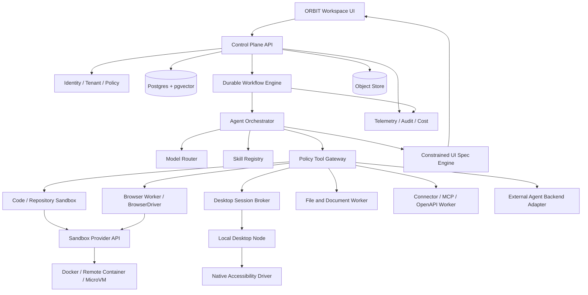

# Expanded ORBIT reference architecture — v0.3

> **Document baseline:** ORBIT 1.0.0-draft (2026-11-08). Earlier version labels are historical unless explicitly marked current.

## Architecture rules

- Control plane owns identity, durable task and approval state, policy, audit, billing/usage and public API contracts.
- Execution plane runs tools in isolated workers. Worker identities are short-lived and scoped to one task/workspace.
- Browser, native desktop, shell/code, file parsing and connectors are distinct driver interfaces with independent policies.
- External agent backends are delegated execution providers, not trusted control planes. ORBIT still owns workspace access and approvals.
- A constrained UI spec engine is a presentation subsystem. It cannot grant permissions or execute tools directly.
- All imported/upstream systems are optional adapters where practical. Use ORBIT-native contracts to avoid vendor lock-in.

## First implementation form

Use a modular monolith for control plane and one or more worker processes. Split services only where isolation, independent scaling or operational ownership justify the cost. Do not start with Kubernetes, Firecracker pools or a microservice fleet by default.

## v0.3 technology integration decisions

Keep the `WorkflowEngine`, `ModelGateway`, `AgentRuntime`, `SandboxProvider`, `ObservabilityExporter` and `SBOMGenerator` contracts internal and replaceable. Evaluate Temporal, LiteLLM, Pydantic AI, OpenSandbox/Daytona, OpenTelemetry, Syft and OSV-Scanner according to `EXTENDED_REFERENCE_STACK_RESEARCH.md`; do not add all candidates by default. ORBIT's own authorization, budgets, approval, evidence, task and audit records remain authoritative.
