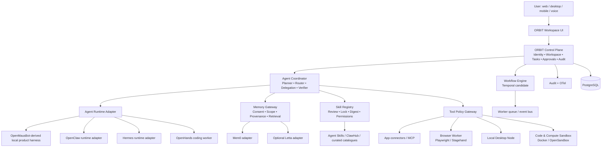

# ORBIT multi-agent personal operating system — v0.4 target architecture

> **Document baseline:** ORBIT 1.0.0-draft (2026-11-08). Earlier version labels are historical unless explicitly marked current.

## Product objective

ORBIT is a personal and work operating system built around a trusted workspace of AI agents. It should help a person move from intention to verified completion across digital work, study, projects, communication, research and personal administration.

The product should feel like one coherent assistant and a roster of specialist agents, not a bundle of unrelated chatbots. Each agent has a role, instructions, preferred model, tools, memory scope, work folder, execution environment and explicit capabilities. Users can delegate work, follow progress, intervene, approve sensitive actions and inspect deliverables.

## Foundation choice

1. If the actual ORBIT repository lacks a complete desktop/web chat product, use the public OpenMausBot edition as the first product-shell baseline after an upstream audit.
2. If ORBIT already has valuable working code, preserve it and import specific tested modules. Do not replace it simply because an upstream project looks larger.
3. Use OpenClaw and Hermes as optional external runtimes/backends. Select at most one as the primary agent runtime initially; add another only to prove a meaningful capability or model/provider advantage.
4. Keep ORBIT's own user identity, workspace authorization, approval ledger, durable task state, memory governance, audit events and product brand as first-party contracts.

## Logical architecture

## What ORBIT must own

- One canonical person/account identity and workspace/tenant model.
- One agent registry with stable agent IDs, versions, role charters and tool grants.
- One durable task state machine: queued, planning, awaiting approval, running, verifying, completed, failed, cancelled or needs-user-input.
- One approval ledger bound to exact action/target/arguments hash/policy version/actor/expiry.
- One tool gateway that authorizes every external action, regardless of which runtime proposed it.
- One artifact store with provenance, version, checksum and task relationship.
- One memory governance layer with consent, scope, source confidence, expiry, correction and deletion.
- One integration/skill trust registry, lockfile and SBOM.
- One observability/audit stream that records the important lifecycle without leaking secrets or private content.

## Agent identity model

A bot/agent record contains:

- `agent_id`, display name, purpose, role, owner and workspace;
- model preference and fallback policy, with provider-specific capabilities declared;
- system prompt and skill versions, each immutable and reviewable;
- memory namespace and retention settings;
- permitted tools, connector accounts, domains and data scopes;
- working directory and allowed sandbox profile;
- allowed execution backends and device/computer bindings;
- schedule/triggers, notification rules and approval requirements;
- usage/cost budgets, max delegation depth and parallelism limits;
- exportable configuration without credentials, transcript contents or access tokens.

An agent does not possess its own legal identity or authority. A role like CEO or CTO is a task instruction profile, not an actual company officer.

## Multi-agent execution pattern

1. Coordinator classifies the request and creates one durable root task.
2. Planner emits typed subtasks with acceptance criteria, data scopes and allowed tools.
3. Policy gateway validates delegation and allocates least-privilege task capabilities.
4. Worker agents execute in isolated workspaces and emit signed/typed progress events and artifacts.
5. Reviewer agent checks outputs against task criteria and can request changes.
6. Coordinator resolves conflicts, consolidates evidence and asks the user for decisions where needed.
7. ORBIT verifies side effects and artifact presence before marking completion.
8. All child tasks inherit the parent's user-approved scope and cannot broaden it.

## Personal life and work domains

- **Knowledge and research:** web search, paper discovery, source comparison, note synthesis, citations, reading queues and research reports.
- **Education:** study plans, flashcards, quizzes, assignment scaffolds, concept explanations and deadline/routine tracking. The user remains the author and submits work themselves.
- **Projects and software:** repository analysis, issue triage, design, code changes, test execution in isolated sandboxes, pull-request drafts and release notes.
- **Communication:** email/chat triage, draft responses, meeting summaries and action-item extraction. Sending external messages requires approval by default.
- **Scheduling:** calendar planning, reminders, recurring routines, event preparation and availability checks, with timezone and duplicate-trigger safeguards.
- **Files and documents:** local/cloud file search, OCR/document parsing in isolated workers, transformations, spreadsheets, presentations and artifact versioning.
- **Personal administration:** checklists, forms, bookings and household/workflow coordination. Payments, purchases, deletion, account changes and legal submissions require confirmation.
- **Creative work:** image, audio, video, slide, web and prototype creation using approved generators and editors.
- **Device workflows:** user-approved browser/desktop interactions with visible activity, local pause/stop and per-app permission boundaries.
- **Always-on assistance:** optional scheduled or event-triggered work. No microphone, camera, location, inbox or file monitoring without explicit feature-level consent and an easy off switch.

## Model strategy

Provider/model is a replaceable backend choice. ORBIT routes by task requirements, cost ceilings, context window, modality, tool support, data policy and user preference. Local models are useful for private/offline and low-cost work; hosted frontier models can be selected for tasks that justify the cost. Never claim one model is universally best. The router reports selected model, route reason, fallback and estimated/actual spend.

## Boundaries

- ORBIT is not automatically AGI because it has many tools or agents.
- Self-evolution is offline optimization under evaluation and review, not permission for uncontrolled recursive code edits.
- The model cannot grant itself additional tool or memory access.
- No silent side effects: show status, evidence, pending approvals and result.
- Sensitive domains require conservative modes. No autonomous diagnosis/treatment, legal representation/filing, securities/crypto trading, credit, hiring or other high-impact decisions. The system can organize information and prepare drafts, but the user or qualified professional makes the decision.
- No covert surveillance, credential harvesting, access-control bypass, MFA/CAPTCHA evasion or impersonation.

## Product principle

**One workspace, many specialist agents, one trusted control plane.** Upstream projects provide mature subsystems; ORBIT provides identity, context, policy, memory governance and reliable orchestration.
