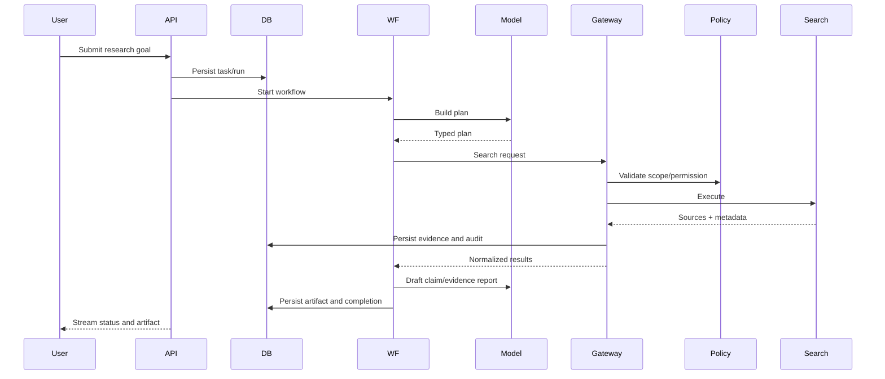
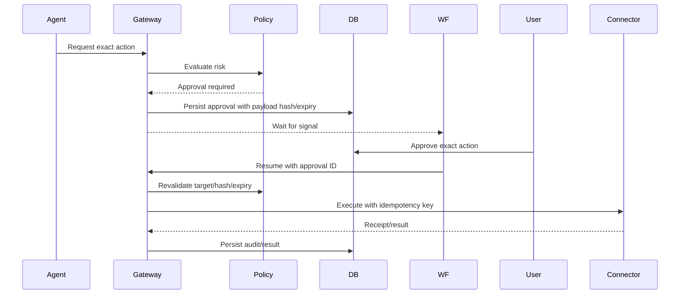

# Sequence Diagrams

> **Document baseline:** ORBIT 1.0.0-draft (2026-11-08). Earlier version labels are historical unless explicitly marked current.

## Research task

## Approved external action

## ORBIT v0.2 alignment

The v0.2 architecture adds a Local Desktop Node and Desktop Session Broker. Native OS access remains separate from Playwright and the code sandbox; see `DESKTOP_COMPUTER_USE_ARCHITECTURE.md` and ADR-013.
