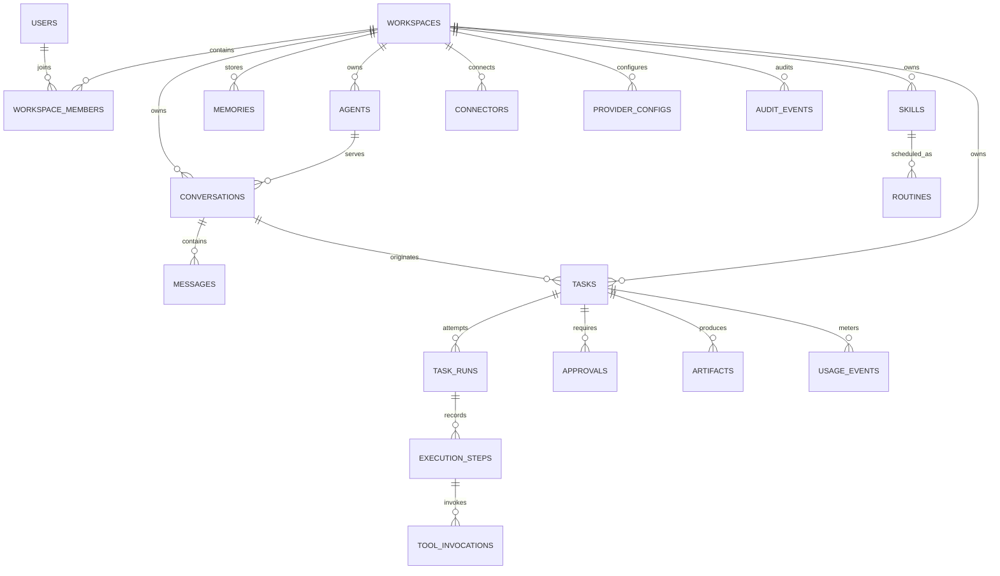
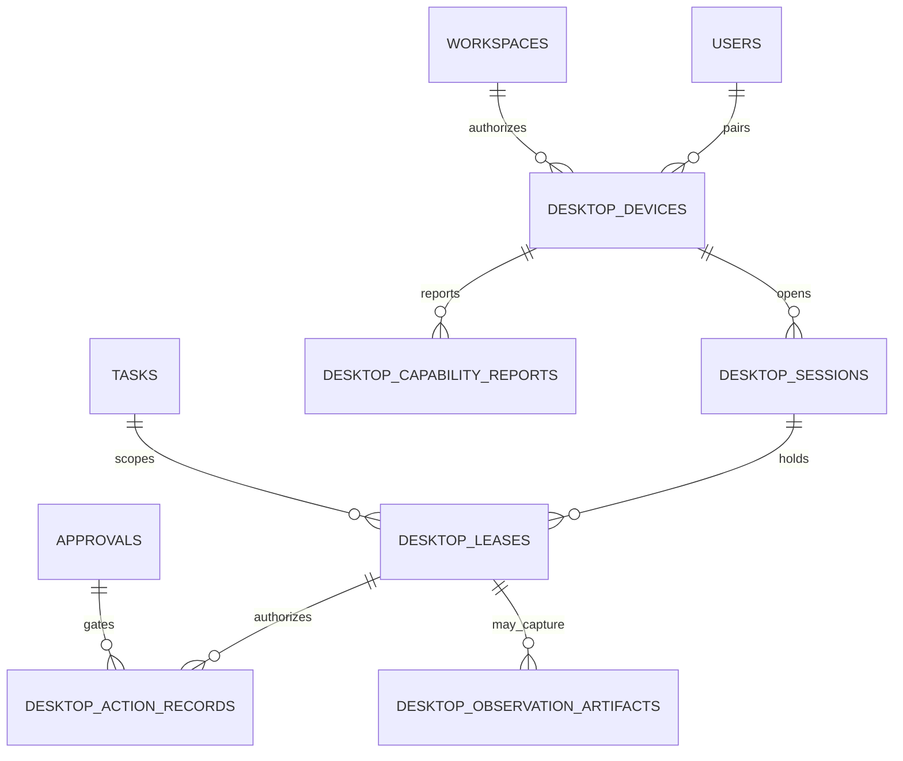

# Entity relationship model

> **Document baseline:** ORBIT 1.0.0-draft (2026-11-08). Earlier version labels are historical unless explicitly marked current.

This conceptual ERD is a logical baseline; concrete naming and constraints live in `DATABASE_SCHEMA.md`.

## Relationship rules

- A task may have many runs after retries, but no more than one active run unless the task explicitly fans out into child tasks.
- An approval is tied to one exact planned action, not a broad “allow this agent” checkbox.
- Agent and skill configuration changes create immutable versions; active tasks retain the version with which they started.
- Artifacts inherit workspace access rules and may be shared only through an explicit share grant.
- Memories can be owned by a user, agent, project, or workspace; retrieval must apply the owner ACL before semantic ranking.

## v0.2 desktop relationships

Desktop refs are intentionally omitted from durable relationships: they expire with the snapshot. Only hashes/context necessary for audit are retained.

## ORBIT v0.2 alignment

The v0.2 system contract adds desktop device, session, capability, lease, action and observation metadata. All operations are typed and policy checked; see `DESKTOP_CONTROL_API_AND_DATA_CONTRACT.md`.
