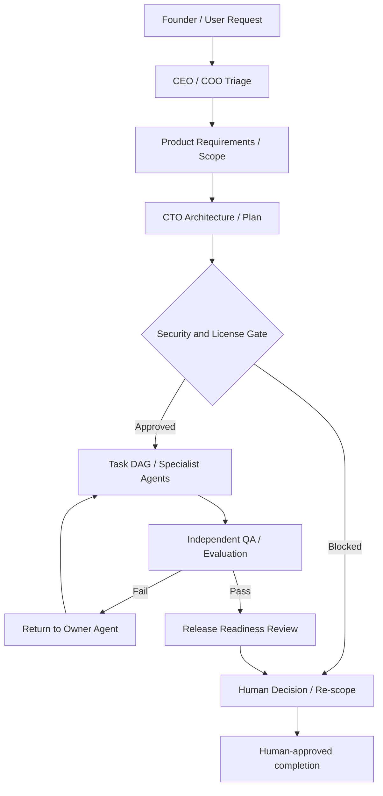

# Agent company orchestration and decision rights

> **Document baseline:** ORBIT 1.0.0-draft (2026-11-08). Earlier version labels are historical unless explicitly marked current.

## Roles vs agents

A role defines accountability; an agent runtime is the process that performs work. One runtime can fulfil several roles sequentially. Multiple roles do not imply multiple independent brains or employees.

## Orchestrator flow

## Delegation and execution policy

- Start with one agent and split only independent subtasks.
- Child agents receive scoped file paths, requirements, tools and budget. Parent authority is not inherited wholesale.
- Limit fan-out, depth, concurrency and total tokens/cost.
- Keep task DAG durable and resume from acknowledged events.
- Each child emits structured result, changed files, evidence, unresolved risks and test commands.
- Independent verifier checks outputs against acceptance criteria and source evidence.
- Any external side effect or production action routes to approval service.

## Escalation matrix

| Trigger | Escalate to |
|---|---|
| Product scope ambiguity or priority conflict | Founder / Product owner |
| Cross-module architecture or data migration | CTO / Architecture review |
| Tool permission, prompt injection, secret exposure or isolation weakness | Security lead; block until resolved |
| Unknown/ambiguous third-party license | Legal/IP advisor and qualified counsel |
| Budget threshold or paid provider activation | Finance and founder |
| Failed acceptance/evaluation | QA + feature owner |
| Production incident | SRE incident commander + founder |
